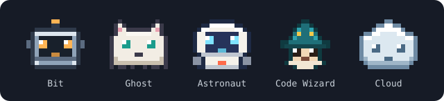
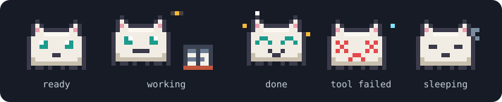
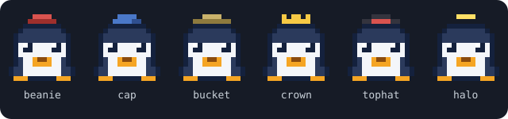
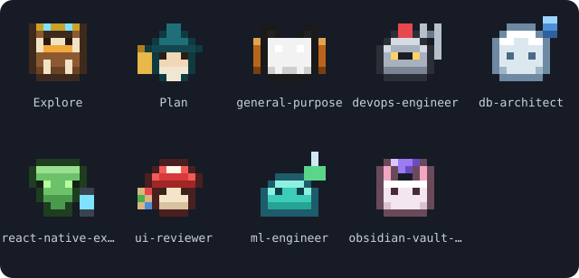
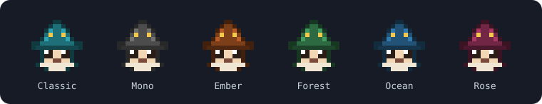

<div align="center">

<a href="README.md"></a>&nbsp;&nbsp;<a href="README.tr.md"></a>

# pixel-agents

**A tiny pixel-art companion that lives above your Claude Code prompt.**



</div>

## Install

Needs Claude Code v2.1.287 or later.

```bash
claude plugin marketplace add diyojenyazilim/claude-plugins
claude plugin install pixel-agents@diyojenyazilim
```

Or inside a session:

```text
/plugin marketplace add diyojenyazilim/claude-plugins
/plugin install pixel-agents@diyojenyazilim
```

If a session is already open, run `/reload-plugins` or start a new one.

## Update

Refresh the marketplace first, then update the plugin:

```bash
claude plugin marketplace update diyojenyazilim
claude plugin update pixel-agents@diyojenyazilim
```

Restart Claude Code, or run `/reload-plugins` in an open session. The VS Code extension needs `Developer: Reload Window`. Check your version with `claude plugin list`.

## Commands

| Command | Does |
| --- | --- |
| `/pixel-agent` | Hide or show the agent |
| `/pixel-agent switch` | Pick a character from a grid |
| `/pixel-agent random` | Switch to a random character |
| `/pixel-agent <name>` | `bit`, `ghost`, `astronaut`, `wizard`, `cloud`, `cat`, `fox`, `frog`, `penguin`, `owl`, `panda`, `bunny`, `dragon`, `pumpkin`, `alien`, `slime`, `mushroom`, `knight`, `octopus`, `cactus` |
| `/pixel-agent hat` | Pick a hat. Hats unlock with bond turns: 10, 25, 50, 100, 200, 400 |
| `/pixel-agent bond` | Bond turns and the next hat |
| `/pixel-agent theme <name>` | `classic`, `mono`, `ember`, `forest`, `ocean`, `rose` (also `next` and `auto`) |
| `/pixel-agent chatter` | Toggle the speech bubble (also `on` and `off`) |
| `/pixel-agent stats` | Session summary |
| `/pixel-agent help` | All commands |

Type `/pixel-agent ` and the options appear as you type. The band has **Hide** (top right), **Random** (bottom right) and, when subagents need a second row, **Expand** / **Collapse**.

<div align="center">
  
  
  
  
</div>

<details>
<summary>Troubleshooting</summary>

A thin line between the rows of the sprite means your terminal is not drawing block characters edge to edge.

- **Windows Terminal:** set `font.builtinGlyphs` to `true` and `font.cellHeight` to `"1.0"` in your profile.
- **VS Code terminal:** set `terminal.integrated.gpuAcceleration` to `"auto"`, `terminal.integrated.customGlyphs` to `true` and `terminal.integrated.lineHeight` to `1`.

The mod reads no files, starts no processes and makes no network requests. The whole source is `hooks/register.tsx`.

</details>

## License

MIT, see [LICENSE](LICENSE).
