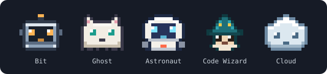
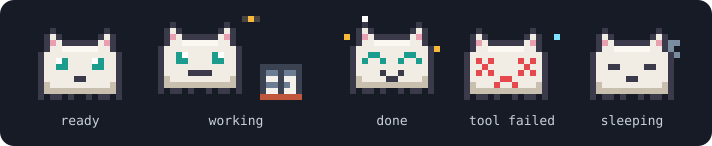
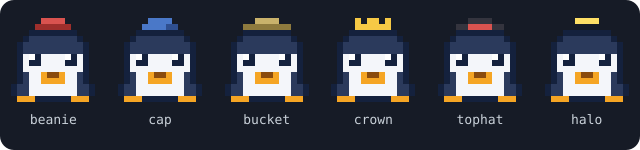
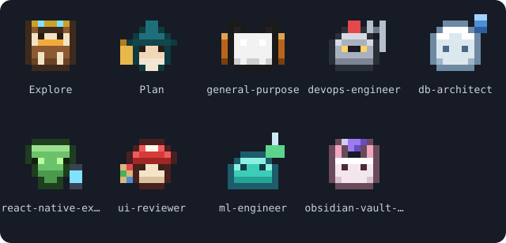
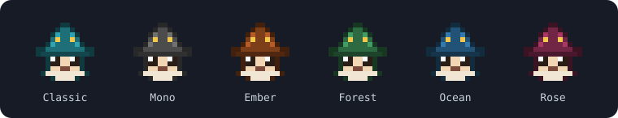

<div align="center">

<a href="README.md"></a>&nbsp;&nbsp;<a href="README.tr.md"></a>

# pixel-agents

**Claude Code isteminin üstünde yaşayan küçük bir piksel arkadaş.**



</div>

## Kurulum

Claude Code v2.1.287 veya üstü gerekir.

```bash
claude plugin marketplace add diyojenyazilim/claude-plugins
claude plugin install pixel-agents@diyojenyazilim
```

Ya da bir oturumun içinden:

```text
/plugin marketplace add diyojenyazilim/claude-plugins
/plugin install pixel-agents@diyojenyazilim
```

Oturum zaten açıksa `/reload-plugins` çalıştır veya yeni bir oturum başlat.

## Güncelleme

Önce marketplace'i yenile, sonra eklentiyi güncelle:

```bash
claude plugin marketplace update diyojenyazilim
claude plugin update pixel-agents@diyojenyazilim
```

Claude Code'u yeniden başlat ya da açık oturumda `/reload-plugins` çalıştır. VS Code uzantısında `Developer: Reload Window` gerekir. Sürümünü `claude plugin list` ile görebilirsin.

## Komutlar

| Komut | Ne yapar |
| --- | --- |
| `/pixel-agents` | Ajanı gizler veya gösterir |
| `/pixel-agents switch` | Karakteri ızgaradan seçersin |
| `/pixel-agents random` | Rastgele bir karaktere geçer |
| `/pixel-agents <ad>` | `bit`, `ghost`, `astronaut`, `wizard`, `cloud`, `cat`, `fox`, `frog`, `penguin`, `owl`, `panda`, `bunny`, `dragon`, `pumpkin`, `alien`, `slime`, `mushroom`, `knight`, `octopus`, `cactus` |
| `/pixel-agents hat` | Şapka seçersin. Şapkalar bağ turuyla açılır: 10, 25, 50, 100, 200, 400 |
| `/pixel-agents bond` | Bağ turu sayısı ve sıradaki şapka |
| `/pixel-agents theme <ad>` | `classic`, `mono`, `ember`, `forest`, `ocean`, `rose` (ayrıca `next` ve `auto`) |
| `/pixel-agents chatter` | Konuşma balonunu açar veya kapatır (ayrıca `on` ve `off`) |
| `/pixel-agents stats` | Oturum özeti |
| `/pixel-agents help` | Tüm komutlar |

`/pixel-agents ` yazınca seçenekler yazdıkça listelenir. Bantta **Hide** (sağ üst), **Random** (sağ alt) ve alt ajanlar ikinci satıra ihtiyaç duyunca **Expand** / **Collapse** düğmeleri bulunur.

<div align="center">
  
  
  
  
</div>

<details>
<summary>Sorun giderme</summary>

Sprite satırları arasında ince bir çizgi varsa terminalin blok karakterleri kenardan kenara çizmiyor demektir.

- **Windows Terminal:** profilinde `font.builtinGlyphs` değerini `true`, `font.cellHeight` değerini `"1.0"` yap.
- **VS Code terminali:** `terminal.integrated.gpuAcceleration` değerini `"auto"`, `terminal.integrated.customGlyphs` değerini `true`, `terminal.integrated.lineHeight` değerini `1` yap.

Mod dosya okumaz, süreç başlatmaz, ağ isteği yapmaz. Kaynağın tamamı `hooks/register.tsx` dosyasındadır.

</details>

## Lisans

MIT, bkz. [LICENSE](LICENSE).
